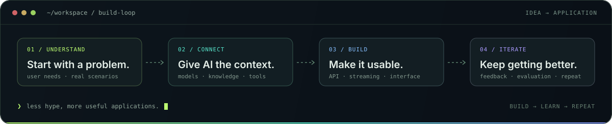

  

  <strong>你好，我是 zhe-w12，一名 AI 应用开发者。</strong> 
  让模型走出对话框，进入真实的工作流。

  <a href="https://github.com/zhe-w12/RoomAI">RoomAI</a>
  &nbsp; / &nbsp;
  <a href="https://github.com/zhe-w12/Multimodal-knowledge-base">Multimodal Knowledge Base</a>
  &nbsp; / &nbsp;
  <a href="https://github.com/zhe-w12?tab=repositories">All repositories ↗</a>

 

<h2>01 / About me</h2>

  我专注于 <strong>AI 应用开发</strong>。比起“模型能回答什么”，我更关心“怎样让模型真正帮人把事做完”——从一个具体问题出发，接入模型与数据、编排 Agent、打磨交互，最后交付一个能日常使用的应用。

目前我主要深耕两个方向：

<ul>
  <li><strong>Agent 工作流</strong>：用 LangGraph 编排工具调用与多步任务，让 AI 参与团队讨论，把想法沉淀为决策和待办。代表项目 <a href="https://github.com/zhe-w12/RoomAI">RoomAI</a>。</li>
  <li><strong>多模态 RAG</strong>：结合文档解析、OCR、视觉理解与混合检索，让回答有来源、可追溯。代表项目 <a href="https://github.com/zhe-w12/Multimodal-knowledge-base">Multimodal Knowledge Base</a>。</li>
</ul>

  我能独立完成从后端到前端的完整链路：<strong>Python / FastAPI</strong> 负责服务、实时通信与流式输出，<strong>React / TypeScript</strong> 负责对话界面与产品体验。在我看来，好的 AI 应用不该停在 Demo，而应该是人们愿意每天打开的工具。

 

<h2>02 / Selected work</h2>

<table>
  <tr>
    <td width="50%" valign="top">
      
<code>01 / AI COLLABORATION</code>

      <h3><a href="https://github.com/zhe-w12/RoomAI">RoomAI ↗</a></h3>
      
<strong>不止聊天，让团队讨论走向行动。</strong>

      
面向小团队的 AI 立项讨论聊天室。实时交流、AI 总结、想法评估与投票，让讨论逐步沉淀为决策、待办和立项纪要。

      
<code>FastAPI</code> <code>WebSocket</code> <code>LangGraph</code> <code>React</code>

      
<a href="https://github.com/zhe-w12/RoomAI">Explore the repository →</a>

    </td>
    <td width="50%" valign="top">
      
<code>02 / MULTIMODAL RAG</code>

      <h3><a href="https://github.com/zhe-w12/Multimodal-knowledge-base">Multimodal Knowledge Base ↗</a></h3>
      
<strong>连接文档与图片，让回答有据可循。</strong>

      
面向教育资料的多模态知识库。结合文档解析、OCR、视觉理解与混合检索，由可调用工具的 RAG Agent 流式回答并展示来源。

      
<code>FastAPI</code> <code>Milvus</code> <code>PaddleOCR</code> <code>React</code>

      
<a href="https://github.com/zhe-w12/Multimodal-knowledge-base">Explore the repository →</a>

    </td>
  </tr>
</table>

  <strong>More code</strong> &nbsp;·&nbsp;
  <a href="https://github.com/zhe-w12/DocuCraft">DocuCraft ↗</a>
  &nbsp;·&nbsp;
  <a href="https://github.com/zhe-w12?tab=repositories">查看全部仓库</a>

 

<h2>03 / Tech stack</h2>

以 AI 应用为核心，Python 与 Java 双栈，从模型、后端到前端都能独立交付。

  

<table>
  <tr>
    <th align="left">Layer</th>
    <th align="left">Technologies</th>
    <th align="left">What I build with them</th>
  </tr>
  <tr>
    <td><strong>AI / Agents</strong></td>
    <td><code>LangGraph</code> <code>LLM APIs</code> <code>Tool Calling</code> <code>Prompt Engineering</code></td>
    <td>模型接入、上下文管理与 Agent 编排</td>
  </tr>
  <tr>
    <td><strong>RAG / Retrieval</strong></td>
    <td><code>Milvus</code> <code>Embedding</code> <code>BM25</code> <code>Rerank</code> <code>PaddleOCR</code></td>
    <td>文档与图片解析、混合检索、重排</td>
  </tr>
  <tr>
    <td><strong>Python Backend</strong></td>
    <td><code>Python</code> <code>FastAPI</code> <code>WebSocket</code> <code>SSE</code></td>
    <td>AI 服务、实时协作与流式输出</td>
  </tr>
  <tr>
    <td><strong>Java Backend</strong></td>
    <td><code>Java</code> <code>Spring Boot</code> <code>Spring MVC</code> <code>MyBatis-Plus</code></td>
    <td>业务系统、RESTful API 与权限管理</td>
  </tr>
  <tr>
    <td><strong>Frontend</strong></td>
    <td><code>React</code> <code>Vue</code> <code>TypeScript</code> <code>Vite</code> <code>Tailwind CSS</code></td>
    <td>对话界面、管理后台与产品交互</td>
  </tr>
  <tr>
    <td><strong>Data / DevOps</strong></td>
    <td><code>MySQL</code> <code>Redis</code> <code>Docker</code> <code>Git</code> <code>Linux</code></td>
    <td>数据存储、缓存与部署运维</td>
  </tr>
</table>

 

<h2>04 / From idea to application</h2>

  

  <strong>少一点空想，多一个能用的应用。</strong> 
  Make it work. Make it useful. Keep improving.

 

  欢迎交流 AI 应用、Agent 与 RAG，也欢迎在项目中提出 Issue 或 PR。 
  <a href="https://github.com/zhe-w12?tab=repositories"><strong>See what I'm building ↗</strong></a>

